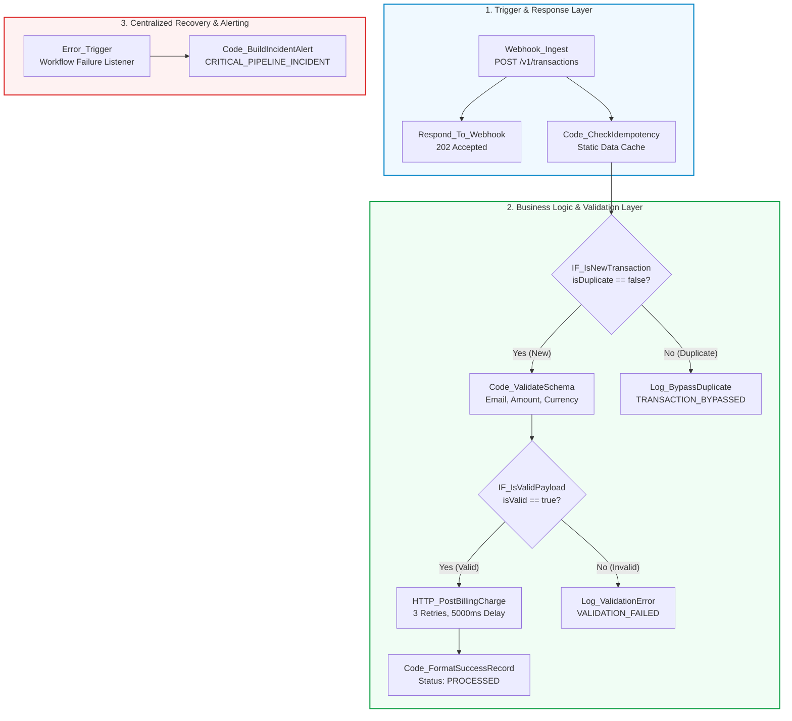

# N8N Hands-On Intermediate Assessment (Level 2)

Welcome to the **N8N Hands-On Intermediate Assessment (Level 2)** repository. This repository contains the production-grade automation workflows, requirements documentation, architecture blueprints, and test plans for intermediate n8n topics.

---

## 📑 Repository Structure

```
Hands_On_Level_2/
├── README.md
└── Topic_1_Production_Workflow_Planning_and_Design_Patterns/
    ├── Topic 1 - Production Workflow Planning.json
    ├── n8n_topic_1_requirement_document.md
    ├── n8n_topic_1_requirement_document.pdf
    └── n8n_topic_1_implementation_plan.pdf
```

---

## 🚀 Topic 1: Production Workflow Planning & Design Patterns

### 1. Objective
Build an idempotent, production-ready transaction processing workflow in n8n that:
- Ingests customer payment requests via an asynchronous HTTP webhook (`POST /v1/transactions`) returning an immediate `202 Accepted` response.
- Enforces an **in-memory idempotency check** using n8n workflow static data to safely bypass duplicate requests.
- Validates payload schemas (RFC 5322 email regex, positive numerical amount, uppercase 3-letter ISO currency).
- Dispatches transactions to an external Billing API with **automated retry policies** (3 retries, 5000ms delay, exponential backoff).
- Routes unrecoverable execution crashes to a **centralized error handler** (`Error Trigger`).

---

### 2. Architecture & Layered Blueprint



---

### 3. Node-by-Node Specification

| Node ID | Node Name | Node Type | Critical Role & Configuration |
| :--- | :--- | :--- | :--- |
| **N1-01** | `Webhook_Ingest` | Webhook | Listens on `POST /v1/transactions` with `responseMode: "responseNode"`. |
| **N1-02** | `Respond_To_Webhook` | Respond to Webhook | Sends immediate `202 Accepted` JSON payload to the caller. |
| **N1-03** | `Code_CheckIdempotency` | Code (JavaScript) | Checks `$getWorkflowStaticData('global')` cache for `transactionId`. Limits store to 500 records. |
| **N1-04** | `IF_IsNewTransaction` | IF Node | Condition: `{{ $json.isDuplicate }} == false`. Directs fresh transactions to validation. |
| **N1-05** | `Log_BypassDuplicate` | Code (JavaScript) | Logs duplicate audit event with `TRANSACTION_BYPASSED` and safely terminates flow. |
| **N1-06** | `Code_ValidateSchema` | Code (JavaScript) | Validates email syntax, positive amount, and ISO currency code. Returns sanitized payload. |
| **N1-07** | `IF_IsValidPayload` | IF Node | Condition: `{{ $json.isValid }} == true`. |
| **N1-08** | `Log_ValidationError` | Code (JavaScript) | Logs detailed schema violation reasons with `VALIDATION_FAILED`. |
| **N1-09** | `HTTP_PostBillingCharge` | HTTP Request | Sends sanitized charge to billing endpoint with `Retry on Fail` (3 tries, 5s delay). |
| **N1-10** | `Code_FormatSuccessRecord` | Code (JavaScript) | Formats final audit record with `chargeId`, `amountCharged`, and timestamp. |
| **N1-11** | `Error_Trigger` | Error Trigger | Global listener intercepting unhandled pipeline exceptions. |
| **N1-12** | `Code_BuildIncidentAlert` | Code (JavaScript) | Compiles incident diagnostics (failedNode, errorMessage, executionUrl) for alerting. |

---

### 4. Verification Checkpoints & Testing Guide

#### Test 1: Valid Transaction Intake
Send a valid transaction payload via cURL or Postman:
```bash
curl -X POST https://n8n.tayanasolutions.com/webhook-test/v1/transactions \
  -H "Content-Type: application/json" \
  -d '{
    "transactionId": "TX-10001",
    "customerEmail": "sarah.connor@cyberdyne.io",
    "amount": 249.99,
    "currency": "USD",
    "description": "Enterprise Cloud Subscription"
  }'
```
* **Expected Result:** Immediate `HTTP 202 Accepted`. In n8n execution canvas, all nodes through `Code_FormatSuccessRecord` succeed with status `PROCESSED`.

#### Test 2: Idempotency Bypass Check
Send the exact same request with `TX-10001` a second time:
* **Expected Result:** Webhook returns 202. `Code_CheckIdempotency` sets `isDuplicate: true`. Flow routes to `Log_BypassDuplicate` and halts; `HTTP_PostBillingCharge` is **not** executed.

#### Test 3: Schema Validation Rejection
Send an invalid payload (bad email, negative amount, lowercase currency):
```bash
curl -X POST https://n8n.tayanasolutions.com/webhook-test/v1/transactions \
  -H "Content-Type: application/json" \
  -d '{
    "transactionId": "TX-10002",
    "customerEmail": "not-an-email",
    "amount": -50,
    "currency": "us",
    "description": "Test Bad Order"
  }'
```
* **Expected Result:** Routes to `Log_ValidationError` detailing all 3 schema violations.

---

## 🛠️ How to Import into n8n

1. Open your **n8n canvas**.
2. Click the three dots menu `...` in the top right corner.
3. Select **Import from File**.
4. Choose `Topic_1_Production_Workflow_Planning_and_Design_Patterns/Topic 1 - Production Workflow Planning.json`.
5. Click **Save** (`Ctrl + S`).
