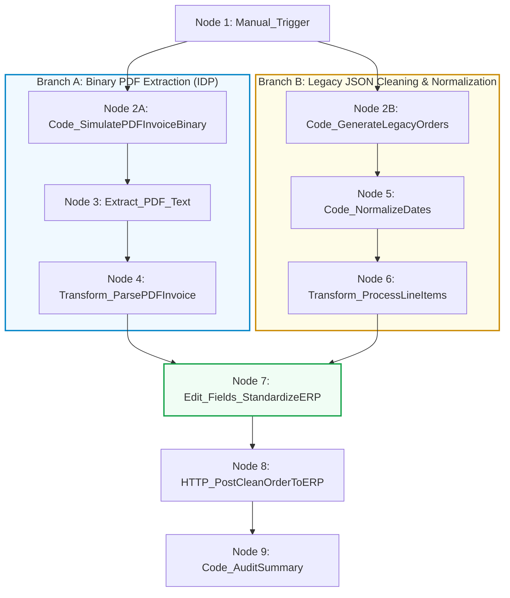

# Requirement Document: N8N Hands-On Intermediate Course
## Topic 2: Advanced Expressions, PDF Data Extraction & Dynamic Data Transformation

---

## 1. Document Control

| Field | Value |
| :--- | :--- |
| **Document Title** | Topic 2: Advanced Expressions, PDF Data Extraction & Dynamic Data Transformation |
| **Course** | N8N - Hands On Intermediate Course (Level 2) |
| **Target Audience** | Automation Builders, System Integrators, QA Engineers |
| **Version** | 1.0 |
| **Status** | Approved |
| **Last Updated** | June 20, 2026 |
| **Prepared By** | Lead Automation Architect |

---

## 2. Learning Concepts & Objectives

### 2.1 Course Objective
Build an enterprise-grade multi-modal data normalization and intelligent document processing (IDP) pipeline in n8n. The workflow ingests both unstructured PDF invoices/receipts and unformatted legacy JSON order streams. It utilizes n8n's **Extract from File (PDF)** node to parse binary documents, applies **Transform Data (Code & Edit Fields)** nodes to parse line items using regex and Luxon timestamps, calculates financial totals and taxes, and dispatches standardized records to an enterprise ERP mock endpoint.

### 2.2 Learning Scope
* **Multi-Modal Data Ingestion:** Handling binary document streams (PDF invoices) simultaneously with legacy JSON REST streams.
* **Intelligent Document Processing (IDP):** Extracting raw text from binary PDF data using n8n native nodes and parsing structured fields (Invoice Number, Date, Vendor, Line Items, Financial Totals) with Regular Expressions.
* **Timestamp & Timezone Normalization:** Using **Luxon** (`DateTime.fromFormat`, `DateTime.fromISO`, `toUTC`) to harmonize irregular dates from disparate source timezones into ISO 8601 UTC.
* **Financial Aggregation & Data Sanitization:** Cleaning dirty currency strings, calculating subtotals, item-level discounts, sales tax (8.5%), and grand totals using array reducers.
* **Enterprise Canonical Schema:** Mapping diverse multi-modal inputs into a standardized canonical ERP payload using the **Edit Fields (Set)** node.
* **Batch Analytics & Auditing:** Aggregating processed order batches and calculating cumulative revenue metrics in a downstream audit handler.

---

## 3. Workflow Architecture

---

## 4. Functional Requirements

| Requirement ID | Section | Requirement Description | Priority |
| :--- | :--- | :--- | :--- |
| **REQ-001** | Multi-Branch Triggering | The workflow shall initiate parallel execution branches for PDF document processing and legacy JSON stream ingestion from a single manual trigger. | High |
| **REQ-002** | Binary PDF Synthesis | The system shall simulate valid PDF binary buffers on the fly to support self-contained testing without external file storage. | High |
| **REQ-003** | PDF Text Extraction | The workflow shall extract unstructured text from binary PDF data using the native `Extract from File` node. | High |
| **REQ-004** | Regex Entity Extraction | The system shall parse metadata (Invoice #, Date, Vendor) and repeat line items using regular expressions from the extracted text. | High |
| **REQ-005** | Luxon Date Normalization | Inconsistent date strings (e.g. `MM/dd/yyyy` vs ISO 8601) shall be parsed with respective timezones and converted into standardized UTC ISO format. | High |
| **REQ-006** | Financial Computation | Currency strings containing currency symbols shall be sanitized, and subtotals, item-level discounts, 8.5% tax, and grand totals shall be computed. | High |
| **REQ-007** | Canonical ERP Mapping | An Edit Fields node shall normalize all records into canonical schema fields (`documentType`, `erpTransactionId`, `accountName`, `contactEmail`, `lineItemCount`, `amountPayable`, `processedAt`). | High |
| **REQ-008** | ERP Dispatch & Batch Audit | Standardized records shall be dispatched to the ERP mock endpoint and aggregated into a batch audit summary with cumulative revenue. | High |

---

## 5. Technical Requirements & Node Specifications

| Node ID | Node Name | Node Type | Key Configuration |
| :--- | :--- | :--- | :--- |
| **N2-01** | `Manual_Trigger` | Manual Trigger | On-demand test runner triggering both processing branches. |
| **N2-02A** | `Code_SimulatePDFInvoiceBinary` | Code (JavaScript) | Generates valid PDF-1.4 stream encoded in Base64 under binary property `data`. |
| **N2-03** | `Extract_PDF_Text` | Extract from File | `operation: "pdf"`, `binaryPropertyName: "data"`. Returns extracted raw text. |
| **N2-04** | `Transform_ParsePDFInvoice` | Code (JavaScript) | Regex parsing of invoice metadata and regex line-item loop into structured JSON. |
| **N2-02B** | `Code_GenerateLegacyOrders` | Code (JavaScript) | Simulates unformatted legacy orders with mixed date formats and dirty customer names. |
| **N2-05** | `Code_NormalizeDates` | Code (JavaScript) | Uses Luxon `DateTime` to parse slash dates and ISO dates with timezones into UTC. |
| **N2-06** | `Transform_ProcessLineItems` | Code (JavaScript) | Sanitizes currency strings, computes lineTotals, subtotal, discount, 8.5% tax, grand total, and title cases names. |
| **N2-07** | `Edit_Fields_StandardizeERP` | Edit Fields (Set) | Maps normalized fields from both branches into canonical ERP schema. |
| **N2-08** | `HTTP_PostCleanOrderToERP` | HTTP Request | POST request sending canonical records to ERP mock endpoint. |
| **N2-09** | `Code_AuditSummary` | Code (JavaScript) | Aggregates all processed items, computing `totalOrdersProcessed` and `cumulativeRevenueUSD`. |

---

## 6. Test Cases & Verification

| ID | Test Case | Steps | Expected Result | Priority |
| :--- | :--- | :--- | :--- | :--- |
| **TC-001** | PDF Ingestion & Parsing | Execute workflow from `Manual_Trigger`. | Node 2A generates PDF, Node 3 extracts text, and Node 4 parses 2 line items, vendor `Acme Industrial Automation Corp`, and total `$670.68`. | High |
| **TC-002** | Legacy JSON Date Normalization | Inspect Node 5 output. | `10/14/2026` from `America/New_York` and `2026-10-15T08:45:00-07:00` from `America/Los_Angeles` both convert to standardized UTC timestamps. | High |
| **TC-003** | Financials & String Cleaning | Inspect Node 6 output. | Dirty currency strings (e.g. ` $129.99 `, `499.00 USD`) are sanitized to numbers, discount & 8.5% tax calculated, and customer names title-cased. | High |
| **TC-004** | Canonical ERP Schema | Inspect Node 7 output. | Both PDF invoice and legacy JSON orders output identical keys with `TX-` prefixed transaction IDs. | High |
| **TC-005** | ERP Ingestion & Audit Summary | Inspect Node 8 & Node 9. | All items successfully posted to ERP endpoint; Node 9 outputs `COMPLETED` batch status with 3 total orders and cumulative revenue. | High |
