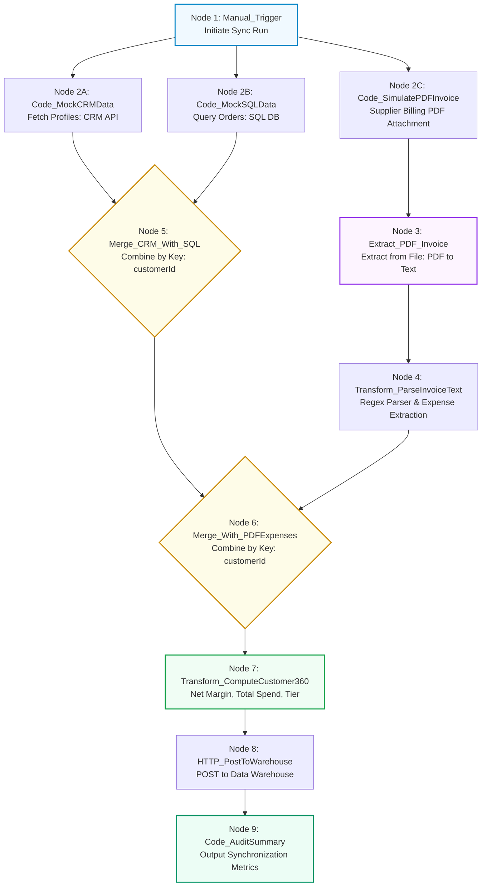

# Requirement Document: N8N Hands-On Intermediate Course
## Topic 6: Multi-Source Data Aggregation, PDF Invoice Extraction & Workflow Synchronization

---

## 1. Document Control

| Field | Value |
| :--- | :--- |
| **Document Title** | Topic 6: Multi-Source Data Aggregation & PDF Invoice Extraction - Requirement File |
| **Course** | N8N - Hands On Intermediate Course (Level 2) |
| **Target Audience** | Enterprise Automation Engineers, Data Engineers, Solutions Architects |
| **Version** | 1.0 |
| **Status** | Approved & Completed |
| **Last Updated** | October 16, 2026 |
| **Prepared By** | Lead Automation Architect |

---

## 2. Learning Concepts & Objectives

### 2.1 Course Objective
Build an enterprise Customer 360 data synchronization and financial reconciliation pipeline in n8n. The workflow ingests customer master records from a CRM API, transaction history from a SQL database, and unstructured supplier expense invoices from binary PDF files. Using n8n's **Extract from File (PDF)** node, regular expression parsing, and multi-stage **Merge** nodes, it unifies heterogeneous data streams on `customerId`, computes financial reconciliation metrics (Revenue, Expenses, Net Margin, and Tier classification), and exports synchronized Customer 360 profiles to a cloud data warehouse mock endpoint.

### 2.2 Learning Scope
* **Multi-Branch Parallel Data Ingestion:** Initiating 3 asynchronous ingestion branches from a single `Manual Trigger` (`Code_MockCRMData`, `Code_MockSQLData`, `Code_SimulatePDFInvoice`).
* **Binary Document Generation & Parsing:** Synthesizing an in-memory binary PDF invoice containing supplier billing text and extracting raw textual strings using the `Extract from File (PDF)` node without external OCR licenses.
* **Regex Financial Line-Item Extraction:** Parsing unstructured invoice text using targeted regular expressions to extract `customerId` and numerical `pdfExpenseUSD`.
* **Multi-Stage Keyed Merging:** Leveraging two sequential `Merge` nodes (Combine mode by matching field `customerId`) to stitch CRM master accounts with SQL sales totals, and then with PDF vendor expenses.
* **Customer 360 Metric Computation:** Calculating net profit margin (`totalSpendUSD - pdfExpenseUSD`) and assigning strategic account tiers (`Enterprise Tier 1` vs `Standard`).
* **Warehouse Data Load & Audit Aggregation:** Dispatching unified records to an external data warehouse ingestion endpoint (`HTTP_PostToWarehouse`) and recording completion audit metrics (`Code_AuditSummary`).

---

## 3. Workflow Architecture

---

## 4. Node Configuration Specifications

| Node ID | Node Name | Node Type | Critical Parameters & Configuration |
| :--- | :--- | :--- | :--- |
| **N6-01** | `Manual_Trigger` | `n8n-nodes-base.manualTrigger` | Manually starts the 3-branch pipeline. |
| **N6-02A** | `Code_MockCRMData` | `n8n-nodes-base.code` (v2) | Emits CRM profiles (`CUST-1001` Apex Logistics, `CUST-1002` Nexus BioTech). |
| **N6-02B** | `Code_MockSQLData` | `n8n-nodes-base.code` (v2) | Emits SQL transactions (`CUST-1001`: $145,200.50, `CUST-1002`: $18,400.00). |
| **N6-02C** | `Code_SimulatePDFInvoice` | `n8n-nodes-base.code` (v2) | Generates valid binary PDF invoice buffer in base64 format under binary property `data`. |
| **N6-03** | `Extract_PDF_Invoice` | `n8n-nodes-base.extractFromFile` (v1) | Operation: `pdf`, Binary Property: `data`. Extracts text payload. |
| **N6-04** | `Transform_ParseInvoiceText` | `n8n-nodes-base.code` (v2) | Uses regex `/CUSTOMER ID:\s*(CUST-[0-9]+)/i` and `/EXPENSE AMOUNT:\s*([0-9.]+)/i` to output `{ customerId, pdfExpenseUSD }`. |
| **N6-05** | `Merge_CRM_With_SQL` | `n8n-nodes-base.merge` (v2.1) | Mode: `combine`, Combination Mode: `mergeByFields`, Field 1: `customerId`, Field 2: `customerId`. Combines CRM + SQL. |
| **N6-06** | `Merge_With_PDFExpenses` | `n8n-nodes-base.merge` (v2.1) | Mode: `combine`, Combination Mode: `mergeByFields`, Field 1: `customerId`, Field 2: `customerId`. Stitches PDF expense line items. |
| **N6-07** | `Transform_ComputeCustomer360`| `n8n-nodes-base.code` (v2) | Computes `netMarginUSD = rev - exp` and assigns Tier (`Enterprise Tier 1` if spend >= $100K else `Standard`). |
| **N6-08** | `HTTP_PostToWarehouse` | `n8n-nodes-base.httpRequest` (v4.2) | Method: `POST`, URL: `https://httpbin.org/post`, Body: `={{ JSON.stringify($json) }}`. Dispatches payload to mock warehouse. |
| **N6-09** | `Code_AuditSummary` | `n8n-nodes-base.code` (v2) | Emits audit summary `{ warehouseSyncStatus: "SUCCESS", totalCustomerProfilesSynced: 2 }`. |

---

## 5. Verification & Testing Checkpoints

### 5.1 PDF Extraction Validation
* Inspect `Extract_PDF_Invoice` output: verifies that `text` property contains `CUSTOMER ID: CUST-1001` and `EXPENSE AMOUNT: 12500.00 USD`.
* Inspect `Transform_ParseInvoiceText`: confirms structured JSON `{ customerId: "CUST-1001", pdfExpenseUSD: 12500 }`.

### 5.2 Multi-Stage Keyed Merge Verification
* `Merge_CRM_With_SQL` accurately pairs CRM profiles with SQL total spends on `customerId`.
* `Merge_With_PDFExpenses` attaches the $12,500 PDF expense to `CUST-1001` while maintaining `CUST-1002` with 0 expense.

### 5.3 Financial Reconciliation Output
* `CUST-1001`: Spend = $145,200.50, Expense = $12,500.00, Net Margin = $132,700.50, Tier = `Enterprise Tier 1`.
* `CUST-1002`: Spend = $18,400.00, Expense = $0.00, Net Margin = $18,400.00, Tier = `Standard`.
* `Code_AuditSummary` confirms `totalCustomerProfilesSynced: 2`.
